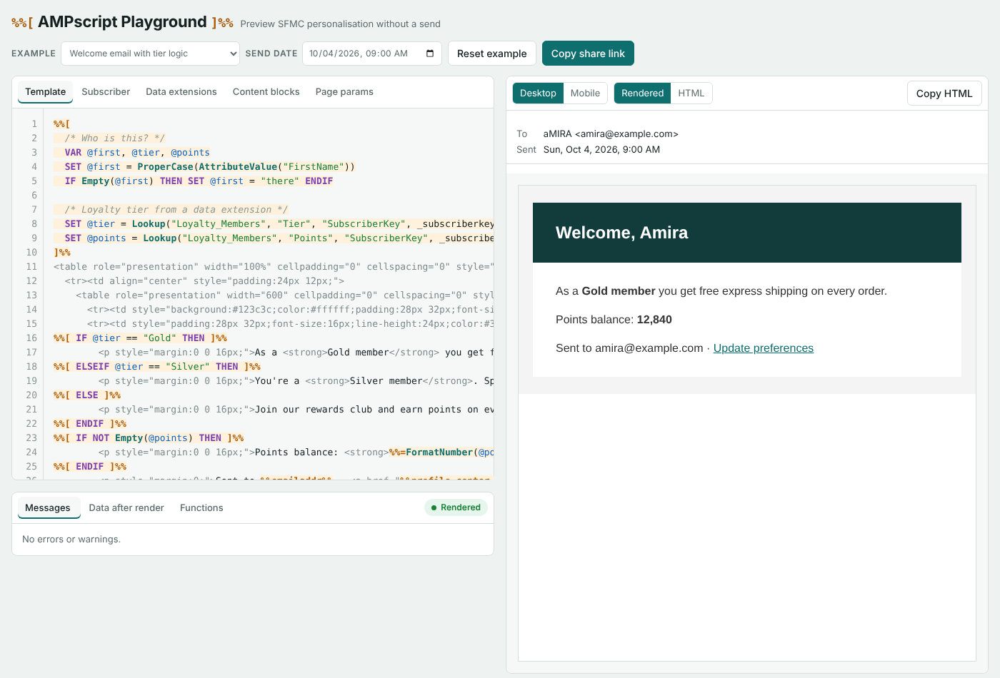
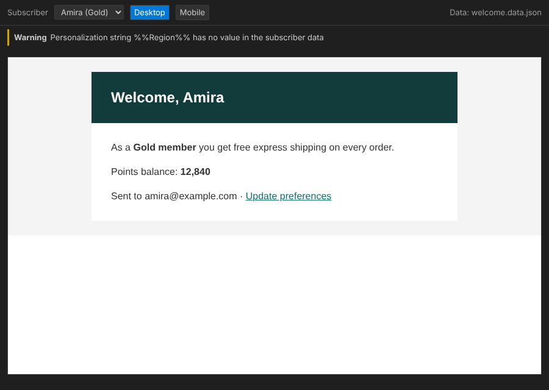

# AMPscript Playground

[](https://github.com/faisal8143/ampscript-playground/actions/workflows/tests.yml)
[](LICENSE)

Render, preview and check **Salesforce Marketing Cloud AMPscript** on your own machine. Plug in test subscribers, data extensions and content blocks, change the send date, and test every branch of your personalisation without a Marketing Cloud login, a publish, or a test send.

One dependency-free JavaScript engine, three ways to use it:

| | |
|---|---|
| 🌐 **[Browser playground](https://faisal8143.github.io/ampscript-playground/)** | Try AMPscript instantly, share a link |
| 🧩 **[VS Code extension](#vs-code-extension)** | Errors as you type, live preview, test subscribers |
| ⚙️ **[CLI for CI](#command-line-and-ci)** | `npx ampscript-playground check emails/` fails the build when a template breaks |



## Why

Testing AMPscript in SFMC is slow: save, preview, pick a subscriber, find the error, repeat. Preview needs real data in real data extensions, and error messages rarely say where the problem is.

The playground gives you a fast loop for the logic:

- **Live preview** as you type, at desktop or mobile width
- **Mock data**: subscriber attributes, data extensions, content blocks and CloudPage parameters as JSON
- **Send date control**: set what `Now()` returns to test birthday, expiry and countdown logic
- **Clear errors with line numbers**, plus friendly hints for common mistakes (`=` instead of `==`, curly quotes, `//` comments, missing `ENDIF`, `Substring` starting at 0)
- **Warnings** for empty personalisation strings and variables used before `SET`
- **Data writes** (`UpsertDE`, `InsertData`, …) applied to the mock data so you can see what a CloudPage would store
- **Share links** that carry your template and data
- Runs entirely in the browser; nothing is sent anywhere

## VS Code extension

**AMPscript Preview & Check** brings the engine into VS Code. No .NET, no local server.



- Errors and warnings in the Problems panel as you type, checked against **every** test subscriber
- Live preview to the side, with a subscriber picker and desktop/mobile width
- **Create Test Data File** builds a starter file from the attributes and data extensions your template uses
- Completion, hover help and parameter hints for 70+ functions
- Syntax highlighting for AMPscript in HTML, `.amp` and `.ampscript` files
- Reads AMPscript Core projects (`subscriber.json`, `DataExtensions/*.csv`, `Content/`) as they are

Install it from the VS Code Marketplace (search **AMPscript Preview & Check**), or download the `.vsix` from the latest [CI run](https://github.com/faisal8143/ampscript-playground/actions/workflows/tests.yml) and use **Extensions → … → Install from VSIX**. Details: [vscode/README.md](vscode/README.md).

## Command line and CI

```bash
npx ampscript-playground check emails/            # every template, every test subscriber
npx ampscript-playground render welcome.html      # print the rendered HTML
npx ampscript-playground init welcome.html        # create welcome.data.json from the template
```

Or install it in a project with `npm install --save-dev ampscript-playground` and run `npx ampscript check`. `check` exits with code 1 when any template fails for any subscriber; add `--strict` to fail on warnings too.

**GitHub Actions** (errors appear as annotations on the pull request):

```yaml
- run: npx ampscript-playground check emails/ --format github
```

### Test data

Found automatically, in this order:

1. `<template-name>.data.json` next to the template
2. the nearest `ampscript.data.json` in the folder or a parent folder
3. AMPscript Core folders: `subscriber.json`, `DataExtensions/*.csv`, `Content/*`

```json
{
  "subscribers": [
    { "_label": "Gold member", "SubscriberKey": "001", "FirstName": "Amira" },
    { "_label": "No first name", "SubscriberKey": "002" }
  ],
  "dataExtensions": { "Loyalty_Members": [ { "SubscriberKey": "001", "Tier": "Gold", "Points": 12840 } ] },
  "contentBlocks": { "footer": "<p>Footer</p>" },
  "requestParameters": { "id": "123" },
  "now": "2026-12-24T09:00:00"
}
```

`dataExtensions` and `contentBlocks` can also be folder paths (one CSV file per data extension).

## What it supports

**Syntax:** `%%[ ]%%` blocks, `%%= =%%` inline output, `<script runat="server" language="ampscript">`, personalisation strings (`%%FirstName%%`, `%%emailaddr%%`, `%%view_email_url%%` …), `[Attribute Name]`, `VAR`, `SET`, `IF / ELSEIF / ELSE / ENDIF` (including around HTML), `FOR … TO / DOWNTO … DO / NEXT`, `AND / OR / NOT`, `/* comments */`. Keywords, function names, attributes and comparisons are case-insensitive, as in SFMC.

**Functions (70+):**

| Area | Functions |
|---|---|
| Output | `Output` `OutputLine` `V` |
| Strings | `Concat` `Length` `Substring` `IndexOf` `Uppercase` `Lowercase` `ProperCase` `Trim` `Replace` `ReplaceList` `Char` `StringToHex` `RegExMatch` |
| Logic & validation | `IIF` `Empty` `IsNull` `IsEmailAddress` `IsPhoneNumber` |
| Maths | `Add` `Subtract` `Multiply` `Divide` `Mod` `Random` |
| Formatting | `Format` `FormatNumber` `FormatCurrency` |
| Dates | `Now` `DateAdd` `DateDiff` `DatePart` `FormatDate` `StringToDate` `DateParse` `SystemDateToLocalDate` `LocalDateToSystemDate` |
| Data extensions | `Lookup` `LookupRows` `LookupOrderedRows` `RowCount` `Row` `Field` `DataExtensionRowCount` `BuildRowsetFromString` `BuildRowsetFromJSON` `InsertDE` `UpsertDE` `UpdateDE` `DeleteDE` `InsertData` `UpsertData` `UpdateData` `DeleteData` |
| Content | `TreatAsContent` `ContentBlockByKey` `ContentBlockByName` `ContentBlockById` `AttributeValue` |
| CloudPages | `RequestParameter` `QueryStringParameter` `CloudPagesURL` `Redirect` `RedirectTo` |
| Utilities | `RaiseError` `Base64Encode` `Base64Decode` `URLEncode` `EscapeDataString` `SHA256` `GUID` |

Functions that call external services (`HTTPGet`, `RetrieveSalesforceObjects`, …) or need SFMC key management (`EncryptSymmetric`) show a clear "not available in the playground" message.

> This is an independent interpreter, not Salesforce's engine. It aims to match SFMC's behaviour for the features above, but formatting and edge cases can differ. Always do a final test send in Marketing Cloud.

## Use the engine in your own code

The interpreter is a single dependency-free file that works in the browser and in Node.js 18+, with TypeScript types.

```bash
npm install ampscript-playground
```

```js
const AMPscript = require('ampscript-playground');

const result = AMPscript.render('Hi %%=ProperCase(AttributeValue("FirstName"))=%%!', {
  subscriber: { FirstName: 'aMIRA' },
  dataExtensions: { Orders: [{ Email: 'a@example.com', Total: 42 }] },
  contentBlocks: { footer: '<p>Footer</p>' },
  requestParameters: { id: '123' },
  now: '2026-10-04T09:00:00'
});

result.html;      // 'Hi Amira!'
result.errors;    // [{ message, line }]
result.warnings;  // ['Personalization string %%LastName%% has no value ...']
result.log;       // data extension writes
```

Handy for **unit-testing AMPscript in CI**: render your templates against fixture data and assert on the output.

## Development

```bash
npm test                  # engine, tooling and CLI tests (no dependencies)
npm run sync:vscode       # copy src/ into the extension after changing the engine
cd vscode && npm ci && npm run test:unit   # extension tests
```

Open `index.html` through any local web server (for example `npx serve .`) to work on the playground UI. The extension's real-VS-Code integration tests run in CI.

## Contributing

Bug reports with a small AMPscript sample are the most helpful thing you can send: what SFMC outputs versus what the playground outputs. See [CONTRIBUTING.md](CONTRIBUTING.md).

## License

[MIT](LICENSE) © Faisal Irfan. Not affiliated with or endorsed by Salesforce. Salesforce, Marketing Cloud and AMPscript are trademarks of Salesforce, Inc.
